<!-- Banner: light/dark aware -->
<picture>
  <source media="(prefers-color-scheme: dark)" srcset="assets/banner-dark.svg">
  
</picture>

  
  
  
  

I build **real-time data platforms** and **LLM-powered agent systems** that run in production. I care about exactly-once data, low-latency streams, and agents that actually ship.

- 🔭 **Now:** SDE-1 at [Easebuzz](https://easebuzz.in) (fintech · payments). I build CDC pipelines processing **10M+ events/day** (Debezium → Kafka → Flink → RisingWave) and multi-agent (MCP + A2A) assistants.
- 🧠 **Before:** AI/ML + full-stack at WayGood EdTech (RAG + RLHF, WhatsApp AI agent) · ML on edge vision for drones at Dragonfly.
- 🏆 SIH 2024 & BOB Fintech Hackathon 2024 **finalist** · **Patent** (AI + Edge IoT) · President, [Aeronauts Drone Society](https://aeronauts.dev), NSUT.
- 🎓 B.Tech CSE (IoT), Netaji Subhas University of Technology, Delhi, 2026.
- 💬 **Ask me about:** CDC & stream processing · Kafka / Flink · LLM orchestration · agentic systems.

## 🚀 Featured projects

<!-- Keep in sync with resume/BaseResume/Basic Information/projects/ and the portfolio /projects pages -->
| Project | What it does | Stack | Links |
|---|---|---|---|
| **Async LLM Orchestration Platform** | Vendor-neutral (MCP) orchestration across OpenAI, Claude and Gemini with provider cascading for **99.95% reliability**; durable event sourcing with deterministic replay; **3.2×** throughput on parallel agent workflows. | Kafka · NATS JetStream · GraphQL/SSE · Python | [Case study](https://devs.profiles.run/projects/llm-orchestration) <!-- TODO: add [Code] once public --> |
| **Conversational Deal Cracker** | Deal-assist platform: 11 microservices, MCP server, RAG agents and a Chrome PWA extension, saving counselors **12+ hrs/week**. | RabbitMQ · gRPC · GraphQL · MongoDB · Kubernetes | [Case study](https://devs.profiles.run/projects/deal-cracker) <!-- TODO: add [Code] once public --> |
| **Human Pattern Recognition SaaS** | Multi-modal vision engine (gesture, age, emotion) at **92%+ accuracy** with distilled models; OIDC + OpenFGA microservices; Three.js/React micro-frontends. | PyTorch · LangChain · React · Three.js | [Code](https://github.com/Redd-hope/HumanPatterns) · [Case study](https://devs.profiles.run/projects/human-patterns) |
| **Knowledge Distillation for Cancer Detection** | Distills a MViT + ViT + YOLO + CNN teacher into a lightweight student model for **real-time inference on embedded devices**. | PyTorch · ViT · YOLO | [Code](https://github.com/Redd-hope/Knowledge-Distillation-for-Cancer-Detection) |

More projects, write-ups and demos → **[devs.profiles.run](https://devs.profiles.run)**

## 💼 Experience

| Role | Company | When |
|---|---|---|
| SDE-1 (Intern → Full-Time) | [Easebuzz](https://easebuzz.in) · fintech / payments | Jan 2026 – Present |
| AI/ML Developer + Full-Stack Architect | WayGood EdTech | Apr 2025 – Jun 2025 |
| Machine Learning Engineer Intern | Dragonfly · drone startup | Jun 2024 – Nov 2024 |

## 🛠️ Tech stack

<!-- Only what's on the resume and defensible in an interview. -->
| | |
|---|---|
| **Languages** |       |
| **Data & Streaming** |         |
| **AI / LLM** |       |
| **Backend & APIs** |       |
| **Databases** |    |
| **Cloud & DevOps** |       |

## 🏆 Achievements

<!-- Proof links go through the portfolio (same slugs as the resume's links.tex) -->
- **Finalist, Smart India Hackathon 2024**: blockchain + AI waste-segregation system; top 0.5% nationwide · [proof](https://devs.profiles.run/proofs/sih-2024)
- **Finalist, BOB Fintech Hackathon 2024**: AI-powered financial risk mitigation system · [proof](https://devs.profiles.run/proofs/bob-hackathon-2024)
- **Patent published**: AI + Edge IoT · [proof](https://devs.profiles.run/proofs/patent)
- **President, [Aeronauts Drone Society](https://aeronauts.dev), NSUT**: led 90+ members across 25 drone R&D projects · [proof](https://devs.profiles.run/proofs/aeronauts-president)

## 📈 Activity

<!-- Generated daily by .github/workflows/snake.yml into the `output` branch -->
<picture>
  <source media="(prefers-color-scheme: dark)" srcset="https://raw.githubusercontent.com/Redd-hope/Redd-hope/output/github-snake-dark.svg">
  
</picture>

---

  Open to conversations about data platforms, AI agents and interesting problems · <a href="https://devs.profiles.run">devs.profiles.run</a>

